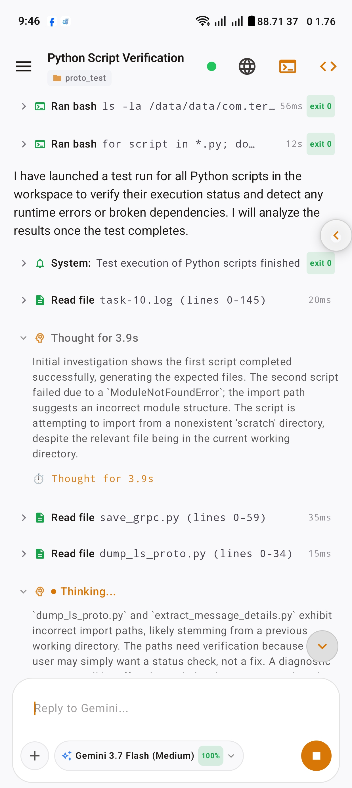
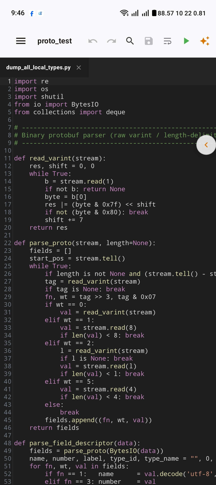
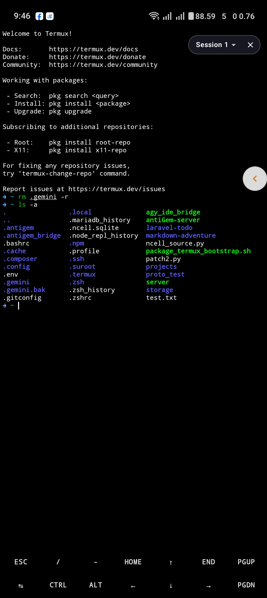
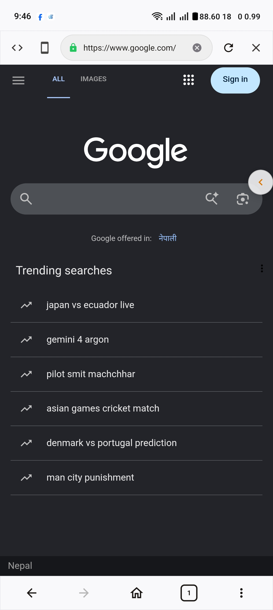
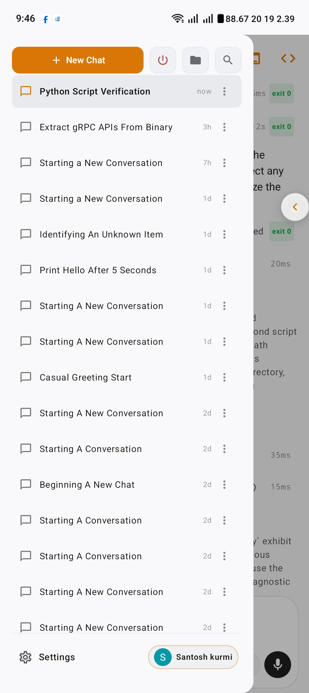
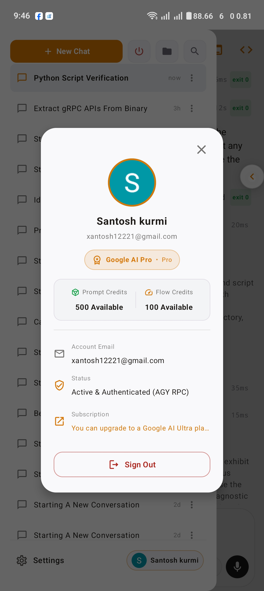
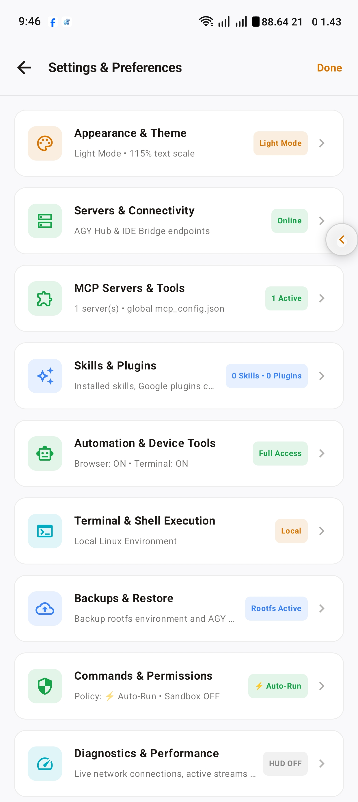

<div align="center">

# AntiGem

**An AI coding workspace for Android: Antigravity and Claude Code agents, a real Linux terminal, a code editor and a browser the agent can control, all in one app.**

[](https://developer.android.com/jetpack/compose)
[](https://go.dev)
[](LICENSE)
[](https://github.com/santoshkurmi/antigem/releases)

[Download](https://github.com/santoshkurmi/antigem/releases) · [Website](https://santoshkurmi.github.io/antigem/) · [Plugin SDK](extension_docs/README.md) · [WhatsApp community](https://chat.whatsapp.com/IGQX8q9zSVV0RarG70sclV?s=cl&p=a&mlu=4&ilr=4)

</div>

---

## Screenshots

<table>
  <tr>
    <td align="center" width="25%"><br><sub>Agent chat</sub></td>
    <td align="center" width="25%"><br><sub>Code editor</sub></td>
    <td align="center" width="25%"><br><sub>Linux terminal</sub></td>
    <td align="center" width="25%"><br><sub>Built-in browser</sub></td>
  </tr>
  <tr>
    <td align="center"><br><sub>Chat history</sub></td>
    <td align="center"><br><sub>Account &amp; quota</sub></td>
    <td align="center"><br><sub>Settings</sub></td>
    <td></td>
  </tr>
</table>

---

## What it is

AntiGem runs two coding agents on your phone:

- **Antigravity (`agy`)**: the app talks to the `agy` language server directly over gRPC.
- **Claude Code**: Anthropic's official `claude` CLI runs inside the app's Linux environment, and the app talks to it over its stream-json protocol, with one CLI process per chat.

You can turn on either agent or both, on first launch or later in **Settings → Agents**. An agent you turn off does not run.

The app reads each agent's structured protocol, not its terminal output. That is how it shows streaming replies, tool approvals, the agent's questions, subagents and file changes as normal chat UI.

---

## Features

### Agents and chat
- Live streaming replies, collapsible thinking, tool cards, diffs and subagent progress.
- Tool approvals, plan approval and the agent's multiple-choice questions, answered inside the chat.
- Switch model, effort, thinking and permission mode during a chat.
- Image and file attachments, voice dictation, and audio playback.
- Edit or regenerate a message, fork, rename, share, export and delete chats.
- Slash commands, plus your own custom slash commands that expand into full prompts.
- Markdown, syntax-highlighted code, Mermaid diagrams and an artifacts drawer.
- A floating chat bubble you can use over other apps.

### Jarvis voice assistant
Use the whole app hands-free by voice, on top of Claude Code or Antigravity. Full guide: **[docs/jarvis.md](docs/jarvis.md)**.
- Open projects and files, switch screens, models and settings (theme too), search code, read chats, check your usage, set timers, and ask how the app works.
- **Tasks:** hand over big jobs ("fix the failing tests and tell me when it's done"). Each runs in its own chat; Jarvis tells you when it finishes, fails, gets stuck, needs an approval or asks a question, and you can redirect or stop it by voice.
- Approvals read out loud and answered by voice, with policies from "ask me each time" to "auto except risky".
- Wake it with the floating orb, a Quick Settings tile, the notification, a headset button, or a wake phrase (hands-free mode, works with the screen off).
- Send with your own phrases ("send it", "bhej do"), cancel with others ("scratch that"), or auto-send on a pause; it ignores what you say to other people.
- Listens again when it expects an answer, quiet mode, male / female / neutral persona, notes about you, device or online voices.
- Turn it on in **Settings → Jarvis**; it is off by default.

### Claude Code
- Install and update the official `claude` CLI from **Settings → Claude Code**.
- Sign in with a Claude subscription or an Anthropic Console account.
- **Third-party providers**: add any Anthropic-compatible API, such as OpenRouter, Kimi or DeepSeek, with your own key. OpenRouter is a one-tap preset that can fetch its free models. Provider models appear in the model picker next to Claude's own.
- Usage at a glance: prompt-cache timer, context window use, 5-hour and weekly plan limits, and token counts for each reply.
- Settings for chat defaults, permission rules, the command sandbox, MCP servers, plugins and marketplaces, `CLAUDE.md` and Claude's memory.

### Antigravity
- Direct gRPC connection to the `agy` daemon.
- Model picker with live quota, Google sign-in and account details.
- Security presets and per-project rules for command auto-run and file access.
- MCP servers, skills and Google plugins.

### Built-in MCP servers
Each one is a one-tap preset in **Settings → MCP Servers**, for both agents.

| MCP | What the agent can do |
| :--- | :--- |
| **Browser** | Open, switch and close tabs, click and type on pages, run JavaScript, inspect the DOM, read console logs, take screenshots, upload files, download URLs and control media. |
| **Terminal** | Create terminal sessions, send commands, read output, kill processes, and change the terminal's theme and font. |
| **Android** | Read the screen's UI tree, tap, swipe, scroll, type, press keys, take screenshots, launch and list apps, open intents, and (with ADB) install, uninstall or force-stop apps and run `adb shell`. |
| **Notes & To-dos** | List, read, create, edit and delete your notes and to-do items. |
| **Custom Plugin** | Use the tools of any installed AntiGem plugin. |
| **Plugin Developer** | Create, install, test and debug AntiGem plugins from the chat. |
| **Jarvis** | Control the app for the Jarvis voice mode: speak and ask, run and watch tasks, chats, models, settings, approvals, the IDE and more ([docs/jarvis.md](docs/jarvis.md)). |
| **Theme** | List, switch, create, edit, import and export the app's color themes. |
| **Stitch** | Google Stitch UI design, with your own API key. |

### Custom AntiGem plugins
- Plugins are small packages with a `manifest.json` and a JavaScript worker that add MCP tools, and can include Markdown **skills** that teach the agent how to use them.
- They run in the app's own extension host, which implements a large part of the Chrome extension API (`tabs`, `scripting`, `storage`, `debugger` and more), so many Chrome extension workers can be ported.
- Install from a ZIP, or from a plugin repository on GitHub. The app checks repositories for updates in the background.
- Enable, disable, reload and update plugins without restarting the app.
- Full SDK, API reference and an example: [extension_docs/](extension_docs/README.md).

### Linux terminal
- A full Termux-based Linux environment with `apt`/`pkg`, bash, Python, Node.js, Git, Go and more. No root and no proot.
- Multiple sessions, themes, font sizes, quick keys and text selection.
- Background service for long-running builds, servers and scripts.
- **ADB Connect**: connects the terminal's `adb` to the same phone over Wireless debugging, with pairing from a notification and automatic reconnects.

### Code editor and Git
- Syntax highlighting for Python, Go, Kotlin, Java, JS/TS, Rust, C/C++, HTML/CSS, JSON, YAML, Markdown and more.
- Tabs, line numbers, find and replace, undo and redo, auto-indent and a file explorer.
- Run commands from the editor in a terminal sheet with Ctrl keys.
- Git: clone, status, diffs, commit, pull and push from a source control view.

### Browser
- In-app browser for previewing local dev servers and testing web apps.
- Desktop and mobile modes, a steady browser identity that keeps Google sign-in working, and built-in Eruda DevTools.

### Notes
- Notes and to-do lists inside the app and in the floating bubble.
- Agents can read and update them through the Notes MCP.

### Backups and updates
- Back up and restore the Linux rootfs, projects and chat history to phone storage.
- Data loss protection: an optional uninstall shield and a guard against **Clear data** in App info.
- In-app update checks and APK updates.
- Diagnostics: a network inspector, live stream counts and daemon logs.

---

## Download

Get the latest APK from [Releases](https://github.com/santoshkurmi/antigem/releases). There are two build variants, and one extra **mode** that works with either of them:

| Variant | Package name | Needs the Termux app? | Notes |
| :--- | :--- | :---: | :--- |
| **`termux`** (recommended) | `com.termux` | No | Self-contained: the app sets up its own Linux environment. This is the one published in releases. |
| **`standard`** | `com.antigem` | Yes | You run `agy_ide_bridge` inside a separately installed Termux app, and AntiGem connects to it over localhost. Not published; build it yourself from source. |
| **Server mode** (a mode, not a third build) | the same as the build you installed (`com.termux` or `com.antigem`) | No | The bridge, the agents (`agy`, Claude Code), your projects and the terminal run on **your own server (a VPS)**, and the phone is only the screen. Switch it on in **Settings → Servers**. Works with both variants. See [Server mode](#server-mode-run-it-on-a-vps) below. |

> [!NOTE]
> The `standard` variant is not deprecated, but it gets little attention because almost nobody uses it. Some features, such as the Browser MCP, may not work in it right now, and it may be dropped in the future. Use the `termux` variant.

> [!IMPORTANT]
> The `termux` variant uses the package name `com.termux`, so it cannot be installed on the same phone as the official Termux app. Uninstall Termux first, or use the `standard` variant.

### Why the package name is `com.termux`

Termux packages are compiled for the fixed path `/data/data/com.termux/files/usr`. An app with any other package name cannot run them directly. It would have to use **proot** to fake that path, and proot slows down every program, or rebuild every package for a new path.

With the package name `com.termux`, AntiGem can install the official Termux bootstrap and use the official Termux package repositories, and everything runs at full native speed. This is the only reason for the name.

### This is not a Termux fork

AntiGem is not a copy or modification of the Termux app. The app was written from scratch. It uses only Termux's open-source **terminal-emulator** and **terminal-view** libraries for drawing the terminal, and the Termux bootstrap and package repositories for the Linux environment. The UI, the agent integrations, the Go bridge, the MCP servers, the plugin system and everything else are AntiGem's own code.

### Termux compatibility

Packages, `apt`/`pkg`, the shell and almost everything else work as in Termux.

AntiGem has essential Termux:API commands built in with zero setup:

| Command | Built in |
| :--- | :---: |
| `termux-toast` | ✅ |
| `termux-vibrate` | ✅ |
| `termux-clipboard-get` / `termux-clipboard-set` | ✅ |
| `termux-torch` | ✅ |
| `termux-tts-speak` | ✅ |
| `termux-notification` / `termux-notification-remove` | ✅ |
| `termux-volume` | ✅ |
| `termux-battery-status` | ✅ |
| `termux-open` / `termux-open-url` | ✅ |
| `termux-wake-lock` / `termux-wake-unlock` | ✅ |

For advanced hardware APIs (such as `termux-location`, `termux-camera-photo`, `termux-sensor`, `termux-sms-*`, `termux-wifi-*`), install the matching signed companion app:

👉 **[Download AntiGem Termux:API Companion App](https://github.com/Santoshkurmi/termux-api/releases)**

> [!IMPORTANT]
> **AntiGem Variant Requirement for Termux:API:**
> - To use the external Termux:API companion app, you **must install the Shared UID variant** (`antiGem-termux-shared-v...apk`). Both apps share the `com.termux` Linux UID to communicate via UNIX sockets.
> - **Existing Users:** Android does not allow changing `sharedUserId` via an update (`INSTALL_FAILED_SHARED_USER_INCOMPATIBLE`). If you currently have the Standalone build installed, you must **backup your files, uninstall the app, and install the Shared UID build**.
> - You can check your current variant in AntiGem under **Settings → About & Info** (shows *Shared UID Build* or *Standalone Build*).

**How to enable:**
1. Install the companion APK from the [releases page](https://github.com/Santoshkurmi/termux-api/releases).
2. In AntiGem, go to **Settings → Terminal & Shell → Termux:API Integration** and select **External Termux:API App**.
3. Tap **Reinstall Package Now** (or run `pkg reinstall termux-api` in the terminal) to restore the official dispatcher binary.

---

## How it works

```
┌──────────────────────────────────────────────────────────┐
│                    AntiGem Android app                   │
│     Compose UI · terminal · editor · browser · MCPs      │
└────────────────────────────┬─────────────────────────────┘
                             │  gRPC / WebSocket (localhost)
┌────────────────────────────▼─────────────────────────────┐
│                agy_ide_bridge (Go, local)                │
│     Git · files · Claude Code relay · plugin manager     │
└───────────────┬──────────────────────────┬───────────────┘
                │ gRPC                     │ stream-json
┌───────────────▼─────────────┐ ┌──────────▼───────────────┐
│  Antigravity (agy) daemon   │ │  Claude Code CLI         │
│                             │ │  (one process per chat)  │
└─────────────────────────────┘ └──────────────────────────┘
```

---

## Server mode (run it on a VPS)

By default everything runs on the phone. In **Server mode** the heavy part moves to a Linux server that you own (a VPS, a home server, a spare PC): the **IDE bridge**, the **Antigravity hub (`agy`)**, **Claude Code**, your **projects, files, git and the shell** all live there, and AntiGem on the phone only shows the UI. It is the same app and the same interface, but the chats, the files and the agents' accounts live on the server (they are separate from any chats you have in local mode), so the agents keep working when the phone sleeps, and the phone stays light.

It is **not a separate APK**. Both the `termux` and the `standard` variant can use it: open **Settings → Servers** and turn on **Remote server (SSH)**. The Linux environment on the phone is not needed in this mode. (Default ports differ per variant: `termux` uses 1234 / 1235 for the bridge / hub, `standard` uses 1236 / 1237.)

```
phone (AntiGem app)                              your server (Linux, x86_64 or arm64)
 ├─ https://bridge.example.com  ──────────────►  nginx / Caddy / Apache ──► agy_ide_bridge (127.0.0.1)
 ├─ https://hub.example.com     ──────────────►  nginx / Caddy / Apache ──► agy hub        (127.0.0.1)
 └─ SSH                          ──────────────►  sshd
      · the app starts / stops the bridge for you (in tmux), shows its log
      · the terminal runs here
      · reverse tunnels: the server's agents can use the phone's browser, Android and notes tools (and adb, if you connect it)
```

### How to set it up (short version)

1. **Prepare the server:** a normal (non-root) user, `sshd`, `tmux`, `git`. Use a **dedicated VPS and a dedicated user**.
2. **Get the bridge on the server:** the app does **not** contain it and never uploads anything. Build it once with Go (`CGO_ENABLED=0 GOOS=linux GOARCH=amd64 go build` in `agy_ide_bridge/`, or `arm64`), copy it to `~/.antigem/agy_ide_bridge` and `chmod +x` it. Build it from the **same version as your app**: the app compares versions on every launch and tells you when the bridge is out of date.
3. **Install the agents on the server:** `curl -fsSL https://antigravity.google/cli/install.sh | bash` for Antigravity, `curl -fsSL https://claude.ai/install.sh | bash` for Claude Code (both end up in `~/.local/bin`). You can also install `agy` from the app (**Settings → Agents**) once the bridge is running.
4. **Put a reverse proxy with TLS in front** (nginx, Caddy or Apache) on two sub-domains, one for the bridge and one for the hub. Strongly recommended: add the **proxy access header** (a second secret that the proxy checks), and open only SSH, 80 and 443 in the firewall.
5. **In the app (Settings → Servers):** turn on Remote server, enter the two addresses, the SSH host, user and key, check the server paths (they are pre-filled with the defaults), optionally the proxy access header, **Save**, **Reopen**. The app connects over SSH, starts the bridge, and shows its state and log.
6. **Sign in** to Antigravity (a Google redirect page that you paste back into the app) and to Claude Code, and start chatting.

**The full, step-by-step guide, with ready-to-paste nginx, Caddy and Apache configurations, the app settings explained field by field, adb from the server to the phone, updating, and debugging, is here: 👉 [docs/remote-server.md](docs/remote-server.md).**

> [!CAUTION]
> **A server on the internet is a target, and nothing here is guaranteed to be secure.** The bridge gives whoever controls it the power of the server user: every file that user can read or write, the agents (which run commands), git, and the logins stored in its home folder. This software is young and has **not been independently audited**; parts of it have had real bugs, and more exist. **Assume your server can be hacked**: use a dedicated VPS and an unprivileged user, keep nothing on it that you cannot afford to lose, use `https://` only, add the proxy access header, open only the ports you need, and keep everything updated.
>
> **Test your protections yourself.** A proxy rule or a firewall setting that you typed in but never checked may do nothing. The guide lists concrete checks to run from another machine (is the access header really enforced, does the bridge refuse a request without the token, which ports are open, does an answer ever contain the secret) in [section 15.5](docs/remote-server.md#155-test-it-yourself-do-not-skip). Repeat them after every change.
>
> **Ask a strong AI model to audit it:** give it this repository's source code and your own proxy configuration, and ask it to look for more bugs and security problems, as described in [section 15.6](docs/remote-server.md#156-ask-an-ai-model-to-look-for-more-bugs). Verify whatever it claims by running it. If you find a real problem, please report it.

The Backups & Restore screen is for the phone's own data and is hidden in Server mode: back up `~/.gemini` and your project folders on the server yourself.

---

## Building from source

**Requirements:** JDK 17+, Android SDK (API 35, Build Tools 35+) and Go 1.23+ for the bridge.

```bash
git clone https://github.com/santoshkurmi/antigem.git
cd antigem

# Build the termux variant
./gradlew assembleTermuxDebug

# Or build every variant
./scripts/build_all_apks.sh
```

APKs are written to `app/build/outputs/apk/<variant>/<buildType>/` and `build/outputs/apk_all/`.

---

## Project structure

```text
antigem/
├── app/src/main/
│   ├── java/com/example/gemini/
│   │   ├── data/          # Agent backends (agy, claude), terminal, ADB, automation, notes, updater
│   │   ├── domain/        # Chat models and parsing
│   │   └── ui/            # Compose screens: chat, IDE, browser, notes, settings
│   ├── java/com/termux/   # Termux terminal-view widget and com.termux service entry points
│   └── assets/browser-runtime/  # Extension host and Chrome API for plugins
├── agy_ide_bridge/        # Go bridge: agy hub, Claude Code relay, Git, plugins
├── extensions/            # Bundled plugins
├── extension_docs/        # Plugin SDK documentation and examples
├── proto_generator/       # Protobuf definitions and generators for the agy API
├── scripts/               # Build, backup and restore scripts
└── version.json           # Version and changelog used by the in-app updater
```

---

## Contributing

Issues, ideas and pull requests are welcome. For help, join the [WhatsApp community](https://chat.whatsapp.com/IGQX8q9zSVV0RarG70sclV?s=cl&p=a&mlu=4&ilr=4).

## Analytics

AntiGem uses [TelemetryDeck](https://telemetrydeck.com) only to count how many people use the app. It records app opens, an anonymous install ID, session counts, and general device details (phone model, Android version, app version). It does **not** collect chats, prompts, code, files, terminal output, account emails or API keys. Debug builds are marked as test data.

## License

Copyright (C) 2026 Santosh Kurmi. Licensed under the [GNU General Public License v3.0](LICENSE) or any later version.
