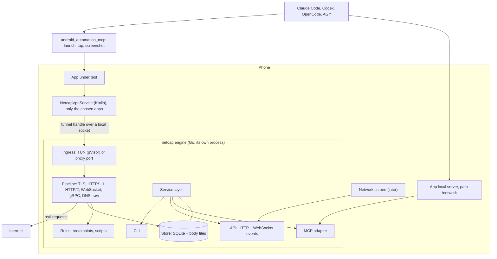

# Network Interceptor (plan)

Status (2026-11-28): Phases 0–4 built and tested on the phone (Android 16, rooted) with the test app
(`netcap/testapp`) against `netcap/cmd/netcap-testserver` on a PC: 32/32 traffic tests pass through the VPN
capture (HTTP/1.1, HTTP/2, h2c, gzip, 20 MB download, 5 MB upload, server-sent events, chunked, gRPC trailers,
WebSocket over TLS and plain, raw TCP, UDP, DNS, QUIC refused in ~2 ms, IPv6, a client that refuses the CA →
passthrough), 4,000 requests at 200/s with no failure, rules / breakpoints / net_send change live app traffic.
Engine on the phone: ~75% of one core at 100 requests/s, ~40–75 MB, 0% when idle. Phase 5 (JS scripts with goja,
external hooks, `net_script`, `net_findings`, `js:` filters) is built and tested on the phone too: scripts changed
HTTP/1.1, HTTP/2 and WebSocket traffic of the test app, hooks took ~0.4–1 ms each (4,000 requests at 200/s with a
script on every request: no failure, same latency as without), external hooks (modify and observe) worked over the
API. Release APKs don't carry the engine: the app downloads it on first use from the GitHub release `netcap-v<version>`
(published by the release workflow) and checks the SHA-256 the APK was built with (06-android.md, "Build and
packaging"). Phase 7, the GUI (a native Network page, a capture bubble over other apps, the engine's `/v1/ui/*` API), is
built and tested on the phone (08-gui.md); Phase 6 (privacy report) is not built. The user-facing name is **Network Interceptor** ("Network Inspector" is the
app's older API-call log).

Built differently from the plan below: the API and the control channel use JSON (no protobuf yet; the GUI phase can
add a schema), live events are server-sent events at `/v1/events` (not WebSocket), small bodies (≤ 64 KB
compressed) are rows in the session database instead of files, agents may start a capture or change the certificate
only when the user turned on "Agents may start a capture".

## What it is

A tool that shows, and can change, the network traffic of chosen apps on the phone. It is for:

- debugging your own apps: what they send, why a request fails, how they react to slow or broken answers
- learning how apps and their APIs work
- checking what data apps send about you (privacy report)

AI agents drive it through `network_mcp`: start a capture, run the app with `android_automation_mcp`, read the
traffic, change it with rules or scripts, and write a report. Later the same engine gets a ProxyPin-style screen so
users can do the basics by hand.

Not part of the app: anything that defeats an app's or a server's security protections, and automated attack tools.
When an app does not accept the AntiGem certificate, its traffic passes through untouched and the list says
"not decrypted".

## Goals

1. **The core debugging tools, as good as Burp, Charles or ProxyPin**: history, breakpoints, send and resend,
   match-and-replace rules, map to a local file or another URL, compare, decoder, scripting. None of Burp's extras.
2. **Built for AI**: complex jobs in few tool calls with small outputs. Repeated work runs inside the engine (rules,
   scripts) instead of passing through the model's context.
3. **Fast and light**: little added delay, big bodies streamed instead of held in memory, no work when there is no
   traffic.
4. **One engine, several faces**: the MCP, a GUI (Android now, VS Code or desktop later) and a command line all use
   the same core code.
5. **Same for every agent**: Claude Code, Codex, OpenCode and AGY get the same MCP.

## How it fits together

## Main decisions (proposed)

| Topic | Choice | Why |
|---|---|---|
| Engine | Go, new module `netcap/` at the repo root, its own binary `netcap` | crash isolation, own lifecycle, builds for PC too; shipped like the bridge |
| Capture on Android | `VpnService` limited to the chosen apps; the tunnel handle goes to the engine over a local socket | no root needed for capture; the rest of the phone is untouched |
| TCP/IP stack | gVisor netstack (pure Go) | used by other Go VPN apps on Android; no cgo |
| HTTPS | one CA per install; root installs it as a system certificate | apps trust system certificates |
| HTTP/3 | blocked in v1, apps fall back to HTTP/2; real HTTP/3 capture later | simple and works for almost every app |
| Storage | SQLite (modernc, pure Go, already in the bridge) + compressed body files | fast filters, small memory |
| Scripts | JS inside the engine (goja or QuickJS-in-Go, decided by a test) + external hooks in any language | AI writes a script once, the engine runs it on every request |
| API | messages defined once in protobuf, served as JSON over HTTP + a WebSocket event stream | one schema for GUI, CLI, VS Code |
| MCP | inside the engine; agents reach it through the app's local server at `/network` | lazy start, same auth as the other app MCPs |

## The documents

| File | What's in it |
|---|---|
| [01-architecture.md](01-architecture.md) | processes, Go packages, control socket, API, data folder, reuse on PC |
| [02-engine.md](02-engine.md) | capture, TLS, HTTP/1.1, HTTP/2, WebSocket, gRPC, DNS, raw, pipeline, speed |
| [03-storage-and-query.md](03-storage-and-query.md) | sessions, database, body files, files for AI, export, filter language, body views |
| [04-mcp.md](04-mcp.md) | `network_mcp` tools, small-context rules, AI workflows |
| [05-rules-and-scripts.md](05-rules-and-scripts.md) | rules, variables, breakpoints, JS runner, external hooks |
| [06-android.md](06-android.md) | VPN service, certificate, app changes, packaging |
| [07-privacy.md](07-privacy.md) | protecting captured data, privacy report |
| [08-gui.md](08-gui.md) | the Network page, bubble and GUI API (as built) |
| [09-phases.md](09-phases.md) | build order, tests, risks |

## Open decisions

1. **Certificate**: the app installs it with root in one tap (recommended), or the user installs it themselves and
   the app only exports it.
2. **Where it lives**: its own page next to Terminal and Files (`AppViewMode.NETWORK`), or under Settings first.
3. **Script engine**: goja or QuickJS-in-Go, decided by the Phase 0 test (05).
4. **GUI**: decided: native Compose page (08).
5. **Tracker list source** for the privacy report (07).
